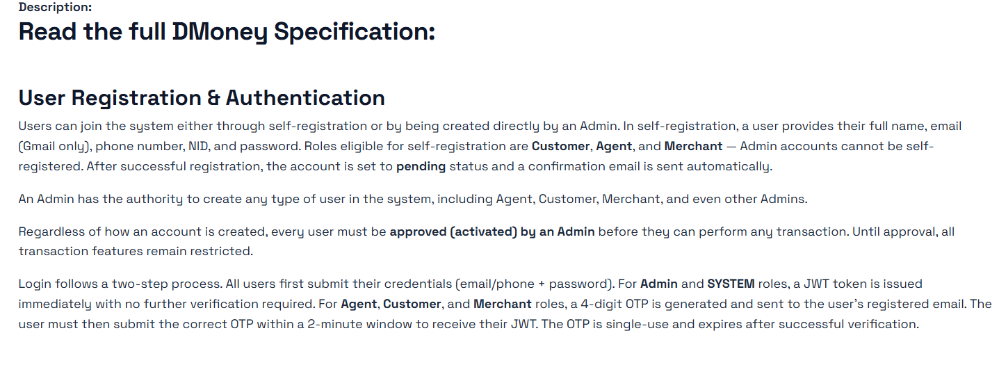
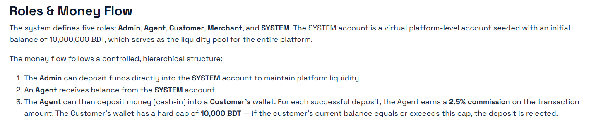
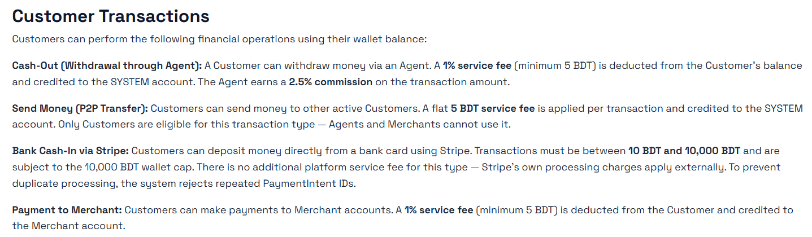
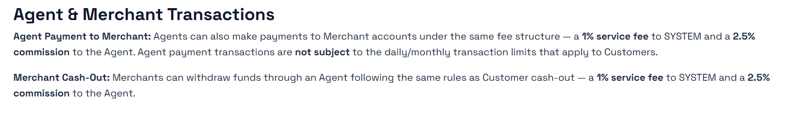
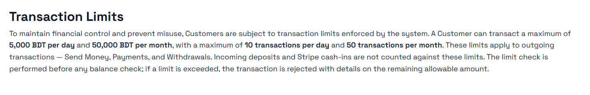
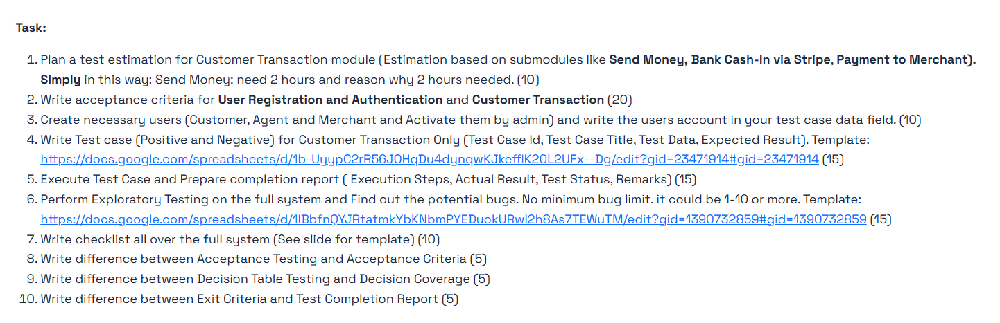

# Assignment on Manual Testing (Dmoney Money Transaction Application)

This repository contains the official assignment requirements and direct access links to my completed QA/SDET work hosted on Google Drive.

---

## 📋 Assignment Questions & Completed Deliverables

## Description's Screenshots

## The Main Task To Deliver

### 🔍 Questions 1, 2, 7, 8, 9, 10
* **Assignment Sheet Description:**
  ![From the sequential 10 task from "Task Block" 6 tasks are solved here with proper methodologies and valid theories ]
* **My Completed Work:** 🔗 [View Answers on Google Docs](https://docs.google.com/document/d/1ufnU43mIMgaCasbV0UICKQdCkuikXA_FVk4FgH4KGng/edit?usp=drive_link)

---

### 📊 Question 3: Necessary User Creation Data Field
* **Assignment Sheet Description:**
  ![Tested the User Creation data with prerequisites,validations,verifications and expected results]
* **My Completed Work:** 🔗 [View Data Fields on Google Sheets](https://docs.google.com/spreadsheets/d/1SeJkrV-vAYW3fo0zFJ7qaMq43cBX6Riu9ZJhnvbLIyc/edit?usp=drive_link)

---

### 🧪 Question 4: Positive & Negative Test Cases
* **Assignment Sheet Description:**
  ![Tested the customer transaction against of **Withdrwa Via Agnet**, **Send Money**, **Bank Cash-In Via Stripe**, **Payment To Merchant** on the basis of both positive & negetive approach ]
* **My Completed Work:** 🔗 [View Test Cases on Google Sheets](https://docs.google.com/spreadsheets/d/1WEY0pRP5f-KDsssOF73AgmIf-26vo84MIMzn0s57KsE/edit?usp=drive_link)

---

### 🏃‍♂️ Questions 6: Bug Report
* **Assignment Sheet Description:**
  ![Reported bug for the application to reduce the application faliure. The total reporting is based on on the methodology of STLC and strategic bug finding with carefully handled severity level in defect reporting phase]
* **My Completed Work:** 🔗 [View Bug Report on Google sheets](https://docs.google.com/spreadsheets/d/1wU_qtwhHOmZSwjOn0VZA_dr5kcdAeN-CNRBDQpffeh8/edit?usp=drive_link)

---

### 🏃‍♂️ Questions 5: Execution Summary
* **Assignment Sheet Description:**
  ![The strategic testing of the DMoney webapplication lastly executed with all good, passed all the critical level failure and with a good completition]
* **My Completed Work:** 🔗 [View Execution on Google Sheets](https://docs.google.com/spreadsheets/d/1uifS8tswdOcIpdf7a6Rx3pdEl2w_mk8zXFzRHVn_XrU/edit?usp=drive_link)

## Necessary Credentials:
**Site URL:** https://dmoneyportal.roadtocareer.net/
**Admin:** email: <example@dmoney.com>; password:<####>
**System account:** email: system@dmoney.com; password:<####>
**Stripe Deposit Card info:** Card No: <0000 0000 0000 0000>; validity: <11/11>; CVV: <000>

## 📂 Complete Assignment Folder Access
If you want to look at the entire file directory directly on Google Drive, use the link below:
👉 **[Open Main Google Drive Directory Workspace](https://drive.google.com/drive/folders/1xgLugVbRdysK0Lt3zjyxk500vP0z8DqH?usp=drive_link)**
